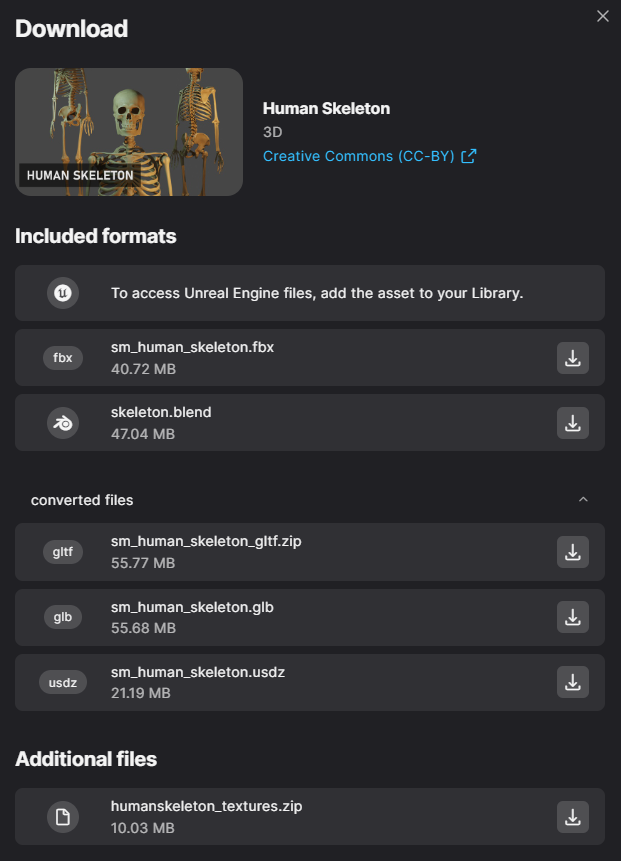

# Adding 3d Models
Here is an example Skeleton Model:
https://www.fab.com/listings/b3b80a03-58b6-4125-b1ef-0b8508f12ed6

Many 3d file downloads will provide several zip file options.  FBX is the standard choice for the Unity 3d model, with the need to download a textures file as well.
